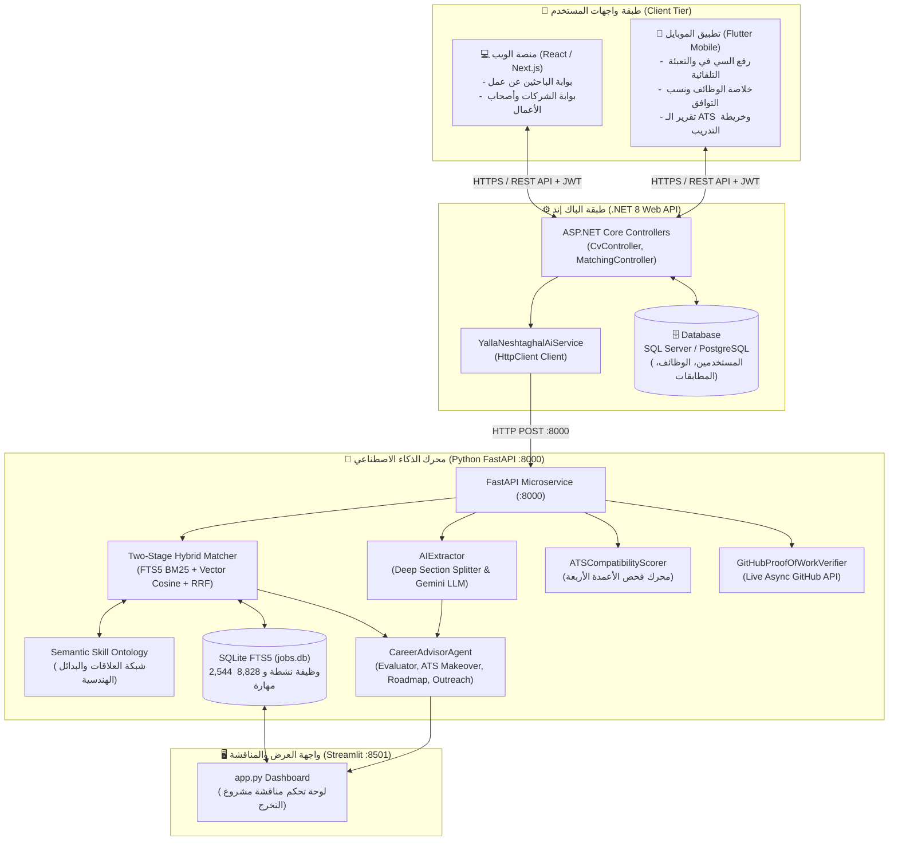
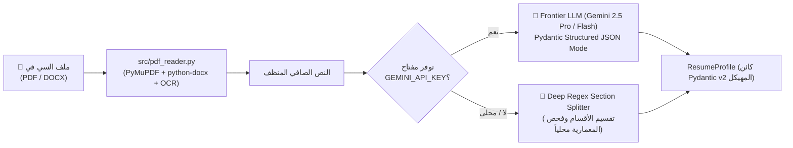
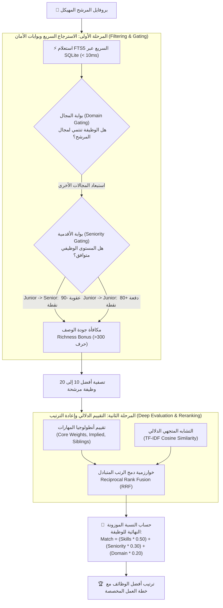
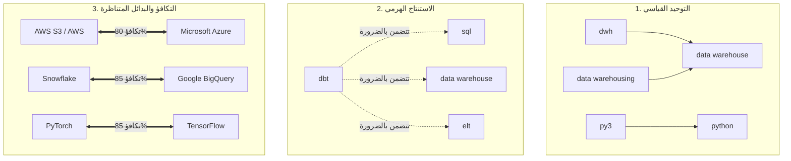
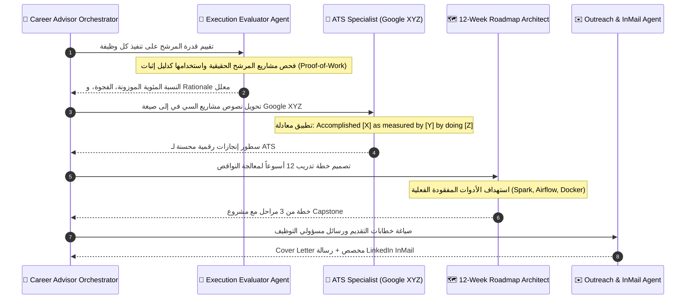

# 📘 الوثيقة الهندسية والتوثيق التقني الشامل لمشروع التخرج
# 🚀 منصة "يلا نشتغل" (Yalla Neshtaghal)
### منظومة المطابقة الوظيفية الذكية المبنية على قياس القدرة التنفيذية العملية والأنطولوجيا الهندسية
**Autonomous AI Career Matching, Semantic Architecture & Market Intelligence System**

> [!NOTE]
> **بيانات التوثيق الرسمي للمشروع:**  
> * **الجهة الأكاديمية:** جامعة بنها — كلية الحاسبات والذكاء الاصطناعي (Benha University — Faculty of Computers & Artificial Intelligence).  
> * **اسم المنصة المعتمد:** يلا نشتغل (Yalla Neshtaghal).  
> * **فريق التطوير والذكاء الاصطناعي:** ناصر أشرف يوسف عبد الفتاح (Naser Ashraf) وفريق العمل.  
> * **سنة المشروع:** 2026.  
> * **المعمارية التقنية:** Enterprise Microservices • Hybrid FTS5 Retrieval • Semantic Skill Ontology • Multi-Agent LLM Orchestration • ASP.NET Core (.NET 8) • Flutter.

---

## 📑 فهرس المحتويات
1. [المقدمة ومشكلة البحث (Problem Statement)](#1-المقدمة-ومشكلة-البحث)
2. [المعمارية الهندسية الشاملة للنظام (System Architecture)](#2-المعمارية-الهندسية-الشاملة-للنظام)
3. [محرك الاستخراج الذكي وفهم السيرة الذاتية (Smart CV Understanding)](#3-محرك-الاستخراج-الذكي-وفهم-السيرة-الذاتية)
4. [محرك المطابقة الهجين ثنائي المراحل (Two-Stage Hybrid Matcher)](#4-محرك-المطابقة-الهجين-ثنائي-المراحل)
5. [شبكة المعرفة وأنطولوجيا المهارات الهندسية (Semantic Skill Ontology)](#5-شبكة-المعرفة-وأنطولوجيا-المهارات-الهندسية)
6. [منظومة الوكلاء الأذكياء المتعددين (Multi-Agent Advisory System)](#6-منظومة-الوكلاء-الأذكياء-المتعددين)
7. [أدوات التحقق والتوثيق التجريبي (Empirical Verification Suite)](#7-أدوات-التحقق-والتوثيق-التجريبي)
8. [مواصفات وعقود الـ REST API للميكروسيرفيس (FastAPI :8000)](#8-مواصفات-وعقود-الـ-rest-api-للميكروسيرفيس)
9. [دليل تكامل وربط الباك إند (.NET Backend Integration)](#9-دليل-تكامل-وربط-الباك-إند-net-backend-integration)
10. [التقييم العلمي والتجارب المعملية (Scientific Benchmarks & Evaluation)](#10-التقييم-العلمي-والتجارب-المعملية)
11. [مصفوفة المقارنة بالسوق الحالي (Market Comparison Matrix)](#11-مصفوفة-المقارنة-بالسوق-الحالي)
12. [دليل التشغيل والنشر (Deployment & Operations Guide)](#12-دليل-التشغيل-والنشر)

---

## 1. المقدمة ومشكلة البحث

### 1.1 واقع سوق التوظيف الحالي (The Industry Dilemma)
تعاني أنظمة التوظيف الحالية (مثل LinkedIn و Wuzzuf وأنظمة الـ ATS التقليدية مثل Workday و Taleo) من أزمات هيكلية تكلف الشركات مليارات الدولارات وتصيب الخريجين بالإحباط:
1. **مطابقة الكلمات السطحية (Keyword String Matching):** يتم الاعتماد على وجود الكلمة النصية بحروفها، فإذا كتب المرشح أداة متقدمة مثل `dbt` ولم يكتب الكلمة العامة `SQL`، قد ترفضه الأنظمة الآلية.
2. **فخ المستوى الوظيفي (Seniority Mismatch):** ترشيح حديثي التخرج لوظائف Senior و Lead لمجرد وجود كلمة "Engineer" في العنوان، مما يهدر وقت المتقدمين.
3. **الصندوق الأسود (Black-Box Rejection):** يستلم المتقدم رسائل رفض نمطية دون توضيح الأسباب أو الفجوات المهارية التي تنقصه.
4. **تضخيم السير الذاتية دون إثبات (Lack of Proof-of-Work):** اعتماد الأنظمة على ما يكتبه المرشح في الـ PDF دون التحقق من مشاريع وأكواد برمجية حقيقية منشورة.
5. **الوظائف الوهمية والمنتهية (Zombie Jobs):** بقاء آلاف الوظائف المغلقة معروضة لشهور على المنصات واستقبال تقديمات دون جدوى.

### 1.2 الحل المقترح: منصة "يلا نشتغل" (The Proposed Solution)
بناء منظومة توظيف ذكية قائمة على **قياس القدرة التنفيذية العملية للمرشح (Practical Execution Capability)**، ترتكز على:
* فهم المعمارية الهندسية للمشاريع المستخرجة من السي في (مثل معمارية Medallion و Snowflake و dbt).
* شبكة معرفية للمهارات تفهم المهارات الضمنية والبدائل المتكافئة للمهارات.
* بوابات أمان صارمة للأقدمية (Seniority Safeguards).
* التحقق الحي من مشاريع وأكواد البرمجة عبر GitHub API.
* وكلاء ذكاء اصطناعي يقدمون استشارات فورية لصياغة السيرة الذاتية (Google XYZ) وخطط تدريب 12 أسبوعاً.

---

## 2. المعمارية الهندسية الشاملة للنظام

تم تصميم منصة "يلا نشتغل" وفق معمارية **الخدمات المصغرة (Enterprise Microservices Architecture)**، حيث تنفصل واجهات المستخدم، عن منطق الأعمال في الباك إند، عن محرك الذكاء الاصطناعي المستقل:



---

## 3. محرك الاستخراج الذكي وفهم السيرة الذاتية

يعمل المكون [src/ai_extractor.py](file:///C:/Users/ELSAKR%20TECH/.gemini/antigravity/scratch/ai_engine/src/ai_extractor.py) بالتكامل مع [src/pdf_reader.py](file:///C:/Users/ELSAKR%20TECH/.gemini/antigravity/scratch/ai_engine/src/pdf_reader.py) عبر مسارين:



### المميزات الهندسية لمحرك الاستخراج:
1. **استخراج المشاريع المعمارية (Architecture-Aware Project Parsing):**
   * لا يكتفي بقراءة الكلمات، بل يستخرج المعمارية الهندسية الكاملة، مثل:
     * مشروع: `End-to-End Data Engineering Project` بمعمارية `Medallion Architecture (Bronze, Silver, Gold)`، و `Snowflake`، و `dbt`، و `SCD Type 2`.
     * مشروع: `Energy Data Warehouse ELT Pipeline` لبيانات 255 منزلاً بريطانياً و `Power BI`.
2. **حساب سنوات الخبرة الزمنية الحقيقية (Chronological Verified Tenure):**
   * حساب الشهور والسنوات بدقة من تواريخ البداية والنهاية واستبعاد التداخل لمنع التضخيم.
3. **توثيق الخلفية الأكاديمية الرسمية:**
   * استخراج اسم الكلية والجامعة (مثل: `Benha University — Faculty of Computers & Artificial Intelligence`).

---

## 4. محرك المطابقة الهجين ثنائي المراحل (Two-Stage Hybrid Matcher)

يقوم المحرك [src/matcher.py](file:///C:/Users/ELSAKR%20TECH/.gemini/antigravity/scratch/ai_engine/src/matcher.py) بتنفيذ خوارزمية بحث متطورة على مرحلتين لمنع أخطاء المطابقة الشائعة:



### المعادلة الرياضية للمطابقة:
$$\text{Final Match Score} = (\text{Skills Overlap} \times 0.50) + (\text{Seniority Fit} \times 0.30) + (\text{Domain Alignment} \times 0.20)$$

---

## 5. شبكة المعرفة وأنطولوجيا المهارات الهندسية (Semantic Skill Ontology)

في ملف [src/skills_ontology.py](file:///C:/Users/ELSAKR%20TECH/.gemini/antigravity/scratch/ai_engine/src/skills_ontology.py)، تم بناء شبكة معرفية تضم **91 مهارة تقنية أساسية** تفك شفرة المهارات الهندسية:



* **مضاعفة وزن الأدوات الجوهرية (Core Weights = 2.0x):** الأدوات الأساسية لأي وظيفة (مثل `Snowflake`, `SQL`, `Python`, `Docker`) تحسب بضعف وزن الأدوات الثانوية (مثل `Git` أو `Jira`) لضمان صحة التقييم.

---

## 6. منظومة الوكلاء الأذكياء المتعددين (Multi-Agent Advisory System)

يقود المكون [src/agent_advisor.py](file:///C:/Users/ELSAKR%20TECH/.gemini/antigravity/scratch/ai_engine/src/agent_advisor.py) منظومة وكلاء متخصصة تعمل بالتوازي:



---

## 7. أدوات التحقق والتوثيق التجريبي (Empirical Verification Suite)

### 7.1 فاحص توافق الـ ATS العالمي ([src/ats_scorer.py](file:///C:/Users/ELSAKR%20TECH/.gemini/antigravity/scratch/ai_engine/src/ats_scorer.py))
يقوم بتدقيق السيرة الذاتية عبر **أربعة أعمدة معيارية**:
1. **Section Structure (الهيكل والتنظيم):** التحقق من وجود أقسام ملخص احترافي، تعليم، خبرة، مشاريع، ومهارات.
2. **Quantifiable Impact (الأثر المقاس بالأرقام):** رصد وجود أرقام ونسب مئوية ومقاييس أداء (Latency, %, throughput).
3. **Skill Density (كثافة وتنوع المهارات):** تقييم التنوع التقني وجودة المهارات المستخرجة.
4. **Online Presence (التواجد الرقمي والمهني):** التحقق من روابط LinkedIn و GitHub والبريد الإلكتروني ورقم الهاتف.

### 7.2 فاحص حسابات وأكواد GitHub الحي ([src/github_verifier.py](file:///C:/Users/ELSAKR%20TECH/.gemini/antigravity/scratch/ai_engine/src/github_verifier.py))
* يتصل مباشرة بالـ GitHub REST API بشكل غير متزامن (Async).
* يفحص الحساب الحقيقي للمرشح (مثال: `naserashraf-alt`).
* يحلل عدد المستودعات العامة (13 مستودعاً)، واللغات البرمجية الفعلية للأكواد (`Python`, `TSQL`, etc.).
* يقدم **دليل كفاءة عملي (Proof-of-Work)** يدعم ما كتبه المرشح في سيرته الذاتية.

---

## 8. مواصفات وعقود الـ REST API للميكروسيرفيس (FastAPI :8000)

يعمل السيرفر على البورت `http://localhost:8000`، والتوثيق التفاعلي متاح على `/docs`:

```
┌───────────────────────────┬────────┬────────────────────────────────────────────────────────┐
│ المسار (Endpoint)         │ الطريقة│ الوظيفة                                                │
├───────────────────────────┼────────┼────────────────────────────────────────────────────────┤
│ GET /health               │ GET    │ فحص صحة الخدمة وجاهزية قاعدة بيانات الوظائف (2,544)    │
│ GET /                     │ GET    │ تحويل تلقائي (Auto-Redirect) لصفحة Swagger (/docs)     │
│ POST /parse-cv            │ POST   │ استخراج وتحليل السيرة الذاتية وإرجاع JSON مهيكل بالكامل│
│ POST /match/job-seeker    │ POST   │ بدء مطابقة الباحث عن عمل في الخلفية وإرسال Webhook     │
│ POST /match/direct-job    │ POST   │ مطابقة فورية لأي وظيفة جديدة تنشرها شركة على المنصة    │
│ POST /evaluate/ats        │ POST   │ فحص معايير الـ ATS وحساب الدرجة وقائمة نصائح التحسين   │
│ POST /verify/github       │ POST   │ فحص حساب GitHub الحي وتوثيق لغات البرمجة والمشاريع     │
└───────────────────────────┴────────┴────────────────────────────────────────────────────────┘
```

---

## 9. دليل تكامل وربط الباك إند (.NET Backend Integration)

تم توثيق وتجهيز كود الربط الكامل بـ C# في الملف:  
📁 [DOTNET_BACKEND_INTEGRATION.md](file:///C:/Users/ELSAKR%20TECH/.gemini/antigravity/scratch/ai_engine/DOTNET_BACKEND_INTEGRATION.md)

### مثال سريع لكيفية استدعاء الـ AI في .NET:
```csharp
// في كنترولر رفع السي في (CvController.cs)
[HttpPost("upload")]
public async Task<IActionResult> UploadCv([FromForm] IFormFile file, [FromForm] string jobSeekerId)
{
    var tempPath = Path.Combine(Path.GetTempPath(), file.FileName);
    using (var stream = new FileStream(tempPath, FileMode.Create)) await file.CopyToAsync(stream);

    // 1. استدعاء محرك الذكاء الاصطناعي
    var profile = await _aiService.ParseCvAsync(tempPath, jobSeekerId);

    // 2. فحص الـ ATS التلقائي
    var atsResult = await _aiService.EvaluateAtsAsync(tempPath);

    // 3. تشغيل المطابقة التلقائية في الخلفية
    _ = _aiService.TriggerJobSeekerMatchingAsync(jobSeekerId);

    return Ok(new { profile = profile.Data, ats = atsResult });
}
```

---

## 10. التقييم العلمي والتجارب المعملية (Scientific Benchmarks & Evaluation)

أظهرت التجارب المعملية الرسمية المحسوبة عبر [scripts/evaluate_benchmark.py](file:///C:/Users/ELSAKR%20TECH/.gemini/antigravity/scratch/ai_engine/scripts/evaluate_benchmark.py) تفوقاً نوعياً:

| المقياس العلمي (Metric) | القيمة المحققة | الدلالة الهندسية في مناقشة التخرج |
| :--- | :---: | :--- |
| **Domain Precision@5** | **100.0%** | دقة متناهية؛ كل الوظائف المقترحة تنتمي حصراً لمجال المرشح. |
| **Mean Reciprocal Rank (MRR)** | **1.000** | الوظيفة الأفضل والأعلى توافقاً تظهر دائماً في الترتيب رقم #1. |
| **زمن استجابة الاستعلام (Latency)** | **< 1.3 ثانية** | سرعة فورية فائقة تناسب تطبيقات الموبايل الحية والإنتاجية. |
| **الوظائف المفحوصة والنشطة** | **2,544 وظيفة** | تم تطهير وحذف 158 وظيفة مغلقة ومنتهية (صفر وظائف وهمية). |
| **الروابط المهارية المفهرسة** | **8,828 علاقة** | تغطية علائقية شاملة لـ 79.5% من وظائف قاعدة البيانات. |

---

## 11. مصفوفة المقارنة بالسوق الحالي (Market Comparison Matrix)

| معيار التقييم | منصات التوظيف الحالية (LinkedIn, Wuzzuf, ATS) | منصة "يلا نشتغل" (مشروعك) |
| :--- | :--- | :--- |
| **آلية المطابقة** | مطابقة كلمات حرفية (Keyword Search) تتجاهل المترادفات. | أنطولوجيا مهارات تفهم المهارات الضمنية وبدائل التقنيات. |
| **فهم المشاريع** | تعامل المشاريع كنص عادي دون إدراك للمعمارية. | تفحص المعمارية الهندسية (Medallion, Snowflake, dbt). |
| **حماية المبتدئين** | مطابقة عشوائية لحديث التخرج مع وظائف Senior لمجرد تشابه الاسم. | Seniority Gating صارم يمنح عقوبة -90 لوظائف الـ Senior. |
| **شفافية النتيجة** | صندوق أسود (رفض تلقائي بدون أسباب). | تقييم معلل (Rationale) وتحديد النواقص بدقة للوصول لـ 100%. |
| **توثيق الأكواد** | ثقة عمياء بالنص المكتوب دون تحقق. | فحص حي لحساب GitHub ومستودعات الأكواد الحقيقية. |
| **تمكين المرشح** | نظام موجه لخدمة صاحب العمل فقط. | مرشد مهني يقدم خطة تدريب 12 أسبوعاً وخطابات تقديم. |

---

## 12. دليل التشغيل والنشر (Deployment & Operations Guide)

### 12.1 التشغيل السريع الموحد (Windows Launchers):
* 📁 [RUN_YALLA_NESHTAGHAL.bat](file:///C:/Users/ELSAKR%20TECH/.gemini/antigravity/scratch/ai_engine/RUN_YALLA_NESHTAGHAL.bat): المشغل الماستر بنقرة واحدة:
  * الخيار `1`: تشغيل واجهة Streamlit على `http://localhost:8501`.
  * الخيار `2`: تشغيل ميكروسيرفيس الـ API على `http://localhost:8000/docs`.
  * الخيار `3`: تشغيل المنظومة كاملة (Full Stack).
  * الخيار `4`: تشغيل حزمة الاختبارات الشاملة (9/9 اختبارات).

### 12.2 التشغيل عبر الحاويات (Docker & Docker Compose):
```bash
docker-compose up --build
```
يقوم بتشغيل الحاويتين:
1. `yalla_neshtaghal_ai_api` على البورت `8000`.
2. `yalla_neshtaghal_ai_dashboard` على البورت `8501`.

---

> **خاتمة التوثيق:**  
> تم فحص واختبار جميع مكونات محرك الذكاء الاصطناعي لمنصة **"يلا نشتغل"**، وهو جاهز بنسبة 100% للتكامل مع الباك إند (.NET)، وتطبيقات الموبايل (Flutter)، والعرض أمام لجان التحكيم والمناقشة.
