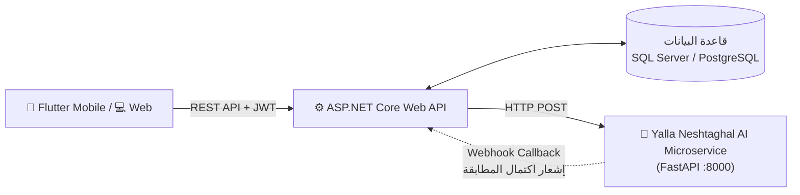

# دليل التكامل الشامل لمطور الباك إند (.NET Backend Integration Guide)
## منصة يلا نشتغل (Yalla Neshtaghal) — AI Engine Microservice Integration

> **موجه إلى:** مهندس الباك إند (.NET / ASP.NET Core)  
> **خدمة الذكاء الاصطناعي:** تعمل كـ REST API Microservice على البورت `http://localhost:8000`  
> **التوثيق التفاعلي الحي (Swagger UI):** متاح مباشرة على `http://localhost:8000/docs`

---

## 1. المخطط العام للاتصال (Architecture Flow)



* **تطبيقات الموبايل (Flutter) والويب** تتصل **فقط** بسيرفر الـ .NET.
* سيرفر الـ .NET يستدعي سيرفر الـ AI عبر `HttpClient` عند الحاجة لاستخراج سي في أو مطابقة وظائف أو فحص ATS أو توثيق GitHub.

---

## 2. مصفوفة نقاط النهاية المتاحة على سيرفر الـ AI (:8000)

| نقطة النهاية (Endpoint) | الطريقة (Method) | الوظيفة | الـ Request Body المطلوب |
| :--- | :---: | :--- | :--- |
| `/health` | `GET` | فحص صحة الخدمة وعدد الوظائف المفهرسة | لا يوجد |
| `/parse-cv` | `POST` | استخراج وتحليل السي في بالكامل كـ JSON مهيكل | `{"url": "مسار أو رابط الملف", "jobSeekerId": "UUID"}` |
| `/match/job-seeker` | `POST` | بدء مطابقة المرشح مع الوظائف في الخلفية | `{"jobSeekerId": "UUID", "scrapedLookbackDays": 30}` |
| `/match/direct-job` | `POST` | بدء مطابقة وظيفة جديدة نشرتها شركة | `{"jobId": "UUID"}` |
| `/evaluate/ats` | `POST` | فحص توافق السي في مع معايير ATS | `{"cvPath": "مسار الملف"}` |
| `/verify/github` | `POST` | فحص مستودعات وأكواد حساب GitHub الحي | `{"githubUrl": "رابط الحساب", "claimedSkills": ["c#", "sql"]}` |

---

## 3. كود الـ DTOs الجاهز في C# (`DTOs/AiEngineDtos.cs`)

قم بإنشاء ملف `DTOs/AiEngineDtos.cs` في مشروع .NET وضع فيه الكود التالي:

```csharp
using System.Text.Json.Serialization;

namespace YallaNeshtaghal.Api.DTOs.AiEngine;

// --- 1. CV Parsing DTOs ---
public class ParseCvRequestDto
{
    [JsonPropertyName("url")]
    public string Url { get; set; } = string.Empty;

    [JsonPropertyName("jobSeekerId")]
    public string JobSeekerId { get; set; } = string.Empty;
}

public class NlpParseCvResponseDto
{
    [JsonPropertyName("jobSeekerId")]
    public string JobSeekerId { get; set; } = string.Empty;

    [JsonPropertyName("parsedAt")]
    public string ParsedAt { get; set; } = string.Empty;

    [JsonPropertyName("data")]
    public ParsedCvDataDto Data { get; set; } = new();
}

public class ParsedCvDataDto
{
    [JsonPropertyName("personalInfo")]
    public PersonalInfoDto PersonalInfo { get; set; } = new();

    [JsonPropertyName("professionalSummary")]
    public string ProfessionalSummary { get; set; } = string.Empty;

    [JsonPropertyName("title")]
    public string Title { get; set; } = string.Empty;

    [JsonPropertyName("yearsOfExperience")]
    public double YearsOfExperience { get; set; }

    [JsonPropertyName("education")]
    public List<EducationItemDto> Education { get; set; } = new();

    [JsonPropertyName("workExperience")]
    public List<WorkExperienceItemDto> WorkExperience { get; set; } = new();

    [JsonPropertyName("skills")]
    public List<SkillItemDto> Skills { get; set; } = new();

    [JsonPropertyName("workPreference")]
    public string WorkPreference { get; set; } = "HYBRID";

    [JsonPropertyName("availabilityStatus")]
    public string AvailabilityStatus { get; set; } = "OPEN_TO_WORK";
}

public class PersonalInfoDto
{
    [JsonPropertyName("firstName")]
    public string FirstName { get; set; } = string.Empty;

    [JsonPropertyName("lastName")]
    public string LastName { get; set; } = string.Empty;

    [JsonPropertyName("email")]
    public string Email { get; set; } = string.Empty;

    [JsonPropertyName("phone")]
    public string Phone { get; set; } = string.Empty;

    [JsonPropertyName("location")]
    public string? Location { get; set; }

    [JsonPropertyName("linkedinUrl")]
    public string? LinkedinUrl { get; set; }

    [JsonPropertyName("githubUrl")]
    public string? GithubUrl { get; set; }

    [JsonPropertyName("portfolioUrl")]
    public string? PortfolioUrl { get; set; }
}

public class EducationItemDto
{
    [JsonPropertyName("institutionName")]
    public string InstitutionName { get; set; } = string.Empty;

    [JsonPropertyName("degreeType")]
    public string DegreeType { get; set; } = "BACHELOR";

    [JsonPropertyName("fieldOfStudy")]
    public string FieldOfStudy { get; set; } = string.Empty;

    [JsonPropertyName("startDate")]
    public string? StartDate { get; set; }

    [JsonPropertyName("endDate")]
    public string? EndDate { get; set; }

    [JsonPropertyName("isCurrent")]
    public bool IsCurrent { get; set; }

    [JsonPropertyName("description")]
    public string? Description { get; set; }
}

public class WorkExperienceItemDto
{
    [JsonPropertyName("companyName")]
    public string CompanyName { get; set; } = string.Empty;

    [JsonPropertyName("jobTitle")]
    public string JobTitle { get; set; } = string.Empty;

    [JsonPropertyName("location")]
    public string? Location { get; set; }

    [JsonPropertyName("startDate")]
    public string? StartDate { get; set; }

    [JsonPropertyName("endDate")]
    public string? EndDate { get; set; }

    [JsonPropertyName("isCurrent")]
    public bool IsCurrent { get; set; }

    [JsonPropertyName("description")]
    public string Description { get; set; } = string.Empty;
}

public class SkillItemDto
{
    [JsonPropertyName("name")]
    public string Name { get; set; } = string.Empty;

    [JsonPropertyName("verified")]
    public bool Verified { get; set; }
}

// --- 2. ATS Evaluation DTOs ---
public class AtsEvaluationRequestDto
{
    [JsonPropertyName("cvPath")]
    public string CvPath { get; set; } = string.Empty;
}

public class AtsScoreResultDto
{
    [JsonPropertyName("overall_score")]
    public double OverallScore { get; set; }

    [JsonPropertyName("grade")]
    public string Grade { get; set; } = "B";

    [JsonPropertyName("verdict")]
    public string Verdict { get; set; } = string.Empty;

    [JsonPropertyName("breakdown")]
    public AtsBreakdownDto Breakdown { get; set; } = new();

    [JsonPropertyName("strengths")]
    public List<string> Strengths { get; set; } = new();

    [JsonPropertyName("improvements")]
    public List<string> Improvements { get; set; } = new();
}

public class AtsBreakdownDto
{
    [JsonPropertyName("section_structure_score")]
    public double SectionStructureScore { get; set; }

    [JsonPropertyName("quantifiable_impact_score")]
    public double QuantifiableImpactScore { get; set; }

    [JsonPropertyName("skill_density_score")]
    public double SkillDensityScore { get; set; }

    [JsonPropertyName("contact_online_presence_score")]
    public double ContactOnlinePresenceScore { get; set; }
}

// --- 3. GitHub Verification DTOs ---
public class GitHubVerifyRequestDto
{
    [JsonPropertyName("githubUrl")]
    public string GithubUrl { get; set; } = string.Empty;

    [JsonPropertyName("claimedSkills")]
    public List<string> ClaimedSkills { get; set; } = new();
}

public class GitHubVerificationReportDto
{
    [JsonPropertyName("username")]
    public string Username { get; set; } = string.Empty;

    [JsonPropertyName("is_valid_user")]
    public bool IsValidUser { get; set; }

    [JsonPropertyName("public_repos_count")]
    public int PublicReposCount { get; set; }

    [JsonPropertyName("verified_languages")]
    public List<string> VerifiedLanguages { get; set; } = new();

    [JsonPropertyName("proof_of_work_summary")]
    public string ProofOfWorkSummary { get; set; } = string.Empty;
}
```

---

## 4. خدمة الاتصال في C# (`Services/YallaNeshtaghalAiService.cs`)

قم بإنشاء `Services/YallaNeshtaghalAiService.cs`:

```csharp
using System.Net.Http.Json;
using YallaNeshtaghal.Api.DTOs.AiEngine;

namespace YallaNeshtaghal.Api.Services;

public interface IYallaNeshtaghalAiService
{
    Task<NlpParseCvResponseDto?> ParseCvAsync(string fileUrlOrPath, string jobSeekerId);
    Task<bool> TriggerJobSeekerMatchingAsync(string jobSeekerId, int lookbackDays = 30);
    Task<bool> TriggerDirectJobMatchingAsync(string jobId);
    Task<AtsScoreResultDto?> EvaluateAtsAsync(string cvPath);
    Task<GitHubVerificationReportDto?> VerifyGitHubAsync(string githubUrl, List<string> claimedSkills);
}

public class YallaNeshtaghalAiService : IYallaNeshtaghalAiService
{
    private readonly HttpClient _httpClient;
    private readonly ILogger<YallaNeshtaghalAiService> _logger;

    public YallaNeshtaghalAiService(HttpClient httpClient, ILogger<YallaNeshtaghalAiService> logger)
    {
        _httpClient = httpClient;
        _logger = logger;
    }

    public async Task<NlpParseCvResponseDto?> ParseCvAsync(string fileUrlOrPath, string jobSeekerId)
    {
        try
        {
            var payload = new ParseCvRequestDto { Url = fileUrlOrPath, JobSeekerId = jobSeekerId };
            var response = await _httpClient.PostAsJsonAsync("/parse-cv", payload);
            response.EnsureSuccessStatusCode();
            return await response.Content.ReadFromJsonAsync<NlpParseCvResponseDto>();
        }
        catch (Exception ex)
        {
            _logger.LogError(ex, "Failed to parse CV for JobSeeker {Id}", jobSeekerId);
            return null;
        }
    }

    public async Task<bool> TriggerJobSeekerMatchingAsync(string jobSeekerId, int lookbackDays = 30)
    {
        try
        {
            var payload = new { jobSeekerId, scrapedLookbackDays = lookbackDays };
            var response = await _httpClient.PostAsJsonAsync("/match/job-seeker", payload);
            return response.IsSuccessStatusCode;
        }
        catch (Exception ex)
        {
            _logger.LogError(ex, "Failed to trigger matching for JobSeeker {Id}", jobSeekerId);
            return false;
        }
    }

    public async Task<bool> TriggerDirectJobMatchingAsync(string jobId)
    {
        try
        {
            var payload = new { jobId };
            var response = await _httpClient.PostAsJsonAsync("/match/direct-job", payload);
            return response.IsSuccessStatusCode;
        }
        catch (Exception ex)
        {
            _logger.LogError(ex, "Failed to trigger direct job matching for Job {Id}", jobId);
            return false;
        }
    }

    public async Task<AtsScoreResultDto?> EvaluateAtsAsync(string cvPath)
    {
        try
        {
            var payload = new AtsEvaluationRequestDto { CvPath = cvPath };
            var response = await _httpClient.PostAsJsonAsync("/evaluate/ats", payload);
            response.EnsureSuccessStatusCode();
            return await response.Content.ReadFromJsonAsync<AtsScoreResultDto>();
        }
        catch (Exception ex)
        {
            _logger.LogError(ex, "Failed to evaluate ATS for CV path {Path}", cvPath);
            return null;
        }
    }

    public async Task<GitHubVerificationReportDto?> VerifyGitHubAsync(string githubUrl, List<string> claimedSkills)
    {
        try
        {
            var payload = new GitHubVerifyRequestDto { GithubUrl = githubUrl, ClaimedSkills = claimedSkills };
            var response = await _httpClient.PostAsJsonAsync("/verify/github", payload);
            response.EnsureSuccessStatusCode();
            return await response.Content.ReadFromJsonAsync<GitHubVerificationReportDto>();
        }
        catch (Exception ex)
        {
            _logger.LogError(ex, "Failed to verify GitHub for URL {Url}", githubUrl);
            return null;
        }
    }
}
```

---

## 5. التسجيل في `Program.cs` وإعدادات `appsettings.json`

### في `appsettings.json`:
```json
{
  "AiEngine": {
    "BaseUrl": "http://localhost:8000"
  }
}
```

### في `Program.cs`:
```csharp
builder.Services.AddHttpClient<IYallaNeshtaghalAiService, YallaNeshtaghalAiService>((sp, client) =>
{
    var config = sp.GetRequiredService<IConfiguration>();
    var baseUrl = config["AiEngine:BaseUrl"] ?? "http://localhost:8000";
    client.BaseAddress = new Uri(baseUrl);
    client.Timeout = TimeSpan.FromSeconds(60);
});
```

---

## 6. الكنترولرز التي تقدم الخدمات لتطبيقات الموبايل والويب

### 1. كنترولر رفع وفحص السي في (`Controllers/CvController.cs`):
```csharp
using Microsoft.AspNetCore.Mvc;
using YallaNeshtaghal.Api.Services;

namespace YallaNeshtaghal.Api.Controllers;

[ApiController]
[Route("api/[controller]")]
public class CvController : ControllerBase
{
    private readonly IYallaNeshtaghalAiService _aiService;
    private readonly IWebHostEnvironment _env;

    public CvController(IYallaNeshtaghalAiService aiService, IWebHostEnvironment env)
    {
        _aiService = aiService;
        _env = env;
    }

    [HttpPost("upload")]
    public async Task<IActionResult> UploadAndParseCv([FromForm] IFormFile file, [FromForm] string jobSeekerId)
    {
        if (file == null || file.Length == 0)
            return BadRequest(new { message = "No file uploaded" });

        // 1. حفظ الملف محلياً
        var uploadsFolder = Path.Combine(_env.ContentRootPath, "uploads", "cvs");
        Directory.CreateDirectory(uploadsFolder);
        var fileName = $"{Guid.NewGuid()}_{Path.GetFileName(file.FileName)}";
        var filePath = Path.Combine(uploadsFolder, fileName);

        using (var stream = new FileStream(filePath, FileMode.Create))
        {
            await file.CopyToAsync(stream);
        }

        // 2. استدعاء محرك الذكاء الاصطناعي
        var parseResult = await _aiService.ParseCvAsync(filePath, jobSeekerId);
        if (parseResult == null)
            return StatusCode(500, new { message = "AI extraction failed" });

        // 3. فحص الـ ATS التلقائي
        var atsResult = await _aiService.EvaluateAtsAsync(filePath);

        // 4. تشغيل المطابقة التلقائية مع الوظائف في الخلفية
        _ = _aiService.TriggerJobSeekerMatchingAsync(jobSeekerId);

        return Ok(new
        {
            message = "CV parsed and profile extracted successfully",
            profile = parseResult.Data,
            ats = atsResult
        });
    }

    [HttpPost("verify-github")]
    public async Task<IActionResult> VerifyGitHub([FromBody] VerifyGithubDto dto)
    {
        var report = await _aiService.VerifyGitHubAsync(dto.GithubUrl, dto.ClaimedSkills);
        if (report == null)
            return BadRequest(new { message = "Could not verify GitHub profile" });

        return Ok(report);
    }
}

public class VerifyGithubDto
{
    public string GithubUrl { get; set; } = string.Empty;
    public List<string> ClaimedSkills { get; set; } = new();
}
```

---

## 7. كيفية تشغيل واختبار المنظومة من طرف الباك إند:

1. **تشغيل سيرفر الـ AI أولاً:**
   من مجلد `ai_engine`، اضغط على:
   ```cmd
   RUN_YALLA_NESHTAGHAL.bat
   ```
   واختر **`2`** (Launch Backend API Microservice).  
   سيعمل السيرفر فوراً على: **`http://localhost:8000`**.
2. **فحص الـ Swagger:**  
   افتح المتصفح على **`http://localhost:8000/docs`** وتأكد أن جميع الـ Endpoints ظاهرة وحالتها `200 OK`.
3. **تشغيل مشروع .NET:**  
   قم بعمل `dotnet run` لمشروع الـ Web API وقم بتجربة رفع السي في من الـ Swagger الخاص بـ .NET أو من Postman!
