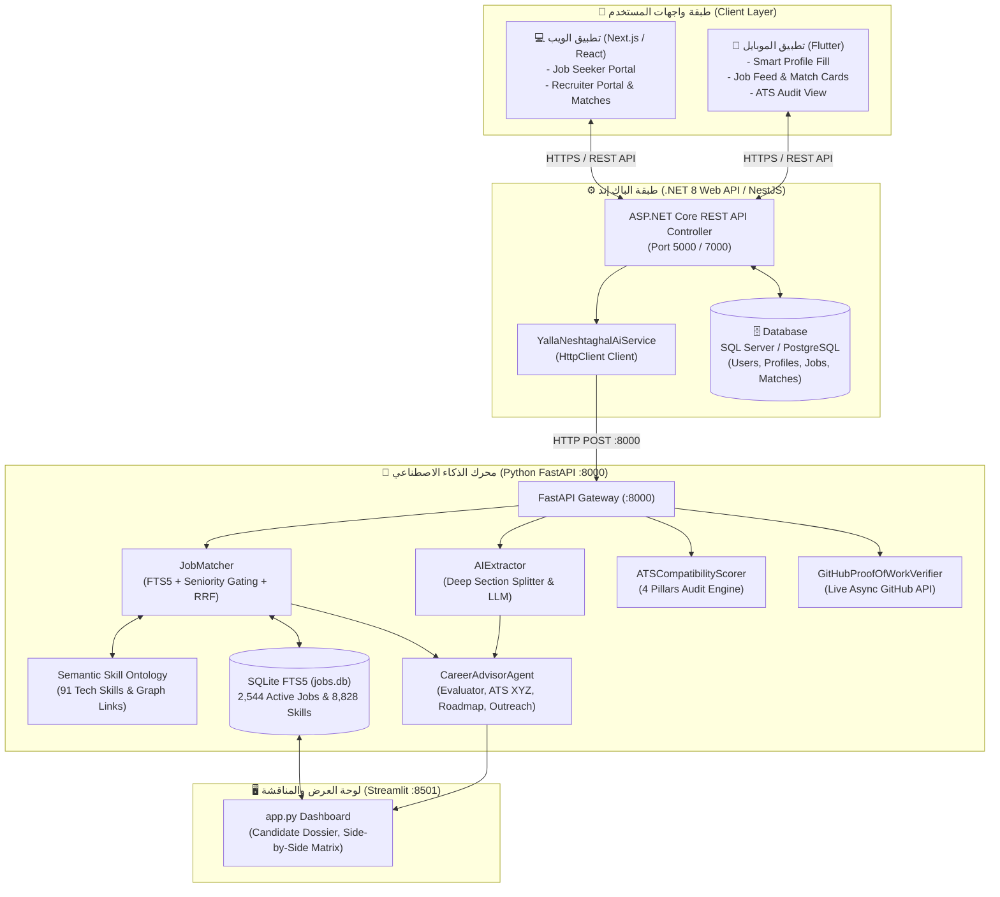
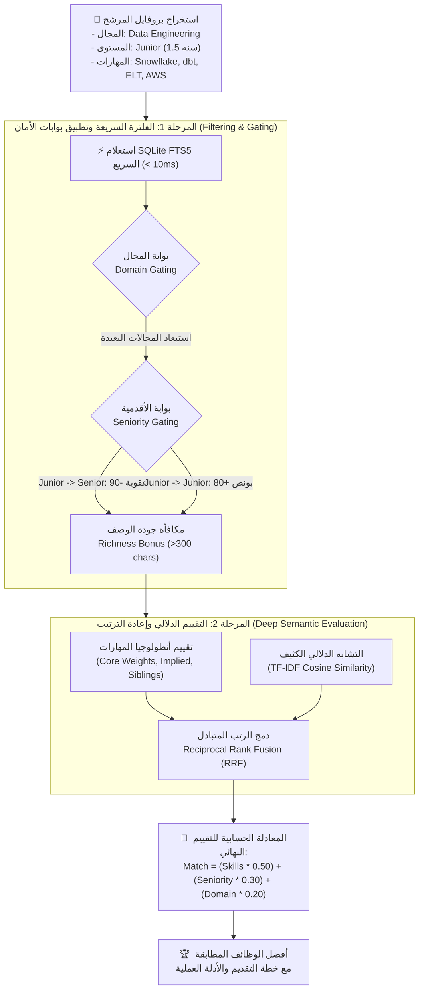
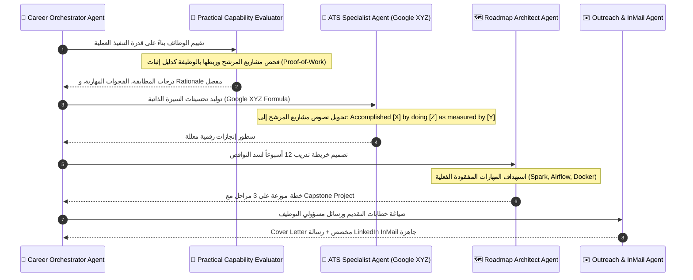
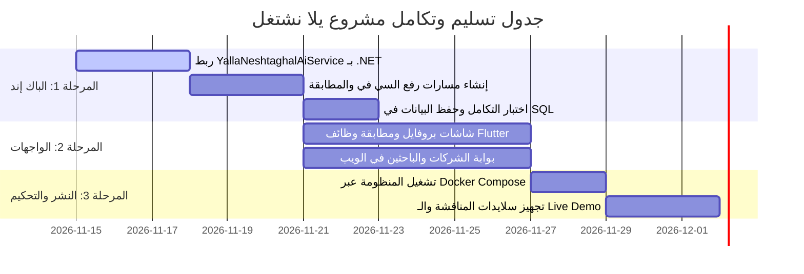

# 🚀 منصة "يلا نشتغل" (Yalla Neshtaghal) — Engineering Wiki & System Blueprint
### Autonomous AI Career Matching, Semantic Architecture & Market Intelligence System

> [!NOTE]
> **وثيقة التوثيق الهندسي الشامل لمشروع التخرج (Graduation Project Master Blueprint & Notion Wiki)**  
> **الكلية:** كلية الحاسبات والذكاء الاصطناعي — جامعة بنها (Benha University — Faculty of Computers & Artificial Intelligence)  
> **المنصة:** يلا نشتغل (Yalla Neshtaghal)  
> **المعمارية الأساسية:** Hybrid Two-Stage Retrieval • Semantic Skill Ontology • Multi-Agent Career Advisory • Enterprise Microservices

---

## 📑 جدول المحتويات (Table of Contents)
1. [المخطط المعماري العام للمنظومة (System Architecture Topology)](#1-المخطط-المعماري-العام-للمنظومة)
2. [معمارية المطابقة الهجينة الثنائية (Two-Stage Hybrid Matching Engine)](#2-معمارية-المطابقة-الهجينة-الثنائية)
3. [أنطولوجيا المهارات الهندسية الدلالية (Semantic Skill Ontology)](#3-أنطولوجيا-المهارات-الهندسية-الدلالية)
4. [منظومة الوكلاء الأذكياء المتعددين (Multi-Agent Advisory System)](#4-منظومة-الوكلاء-الأذكياء-المتعددين)
5. [قاموس الملفات الهندسية ومسؤولياتها (Component & File Dictionary)](#5-قاموس-الملفات-الهندسية-ومسؤولياتها)
6. [عقود ومواصفات الـ REST API Microservice (بورت 8000)](#6-عقود-ومواصفات-الـ-rest-api-microservice)
7. [أدلة التحقق التجريبي والتقييم العلمي (Empirical Benchmarks & Validation)](#7-أدلة-التحقق-التجريبي-والتقييم-العلمي)
8. [مصفوفة المقارنة بالسوق الحالي (Yalla Neshtaghal vs Market)](#8-مصفوفة-المقارنة-بالسوق-الحالي)
9. [خارطة طريق الفريق والمراحل المتبقية (Team Execution Roadmap)](#9-خارطة-طريق-الفريق-والمراحل-المتبقية)

---

## 1. المخطط المعماري العام للمنظومة
تعمل المنصة بنمط **Enterprise Microservices Architecture**، حيث تفصل بين واجهات المستخدم، ومنطق الأعمال الرئيسي في الباك إند، ومحرك الذكاء الاصطناعي المستقل.



---

## 2. معمارية المطابقة الهجينة الثنائية (Two-Stage Hybrid Matching Engine)
تعتمد المنصة على خوارزمية بحث هجينة ثنائية المراحل تضمن أعلى سرعة استرجاع مع أقصى دقة فنية:



---

## 3. أنطولوجيا المهارات الهندسية الدلالية (Semantic Skill Ontology)
تمنع الخوارزمية الفشل الحاصل في أنظمة السوق التي تطابق الكلمات حرفياً، وتعتمد على أنطولوجيا مدمجة في [src/skills_ontology.py](file:///C:/Users/ELSAKR%20TECH/.gemini/antigravity/scratch/ai_engine/src/skills_ontology.py):

| ركيزة الأنطولوجيا | الآلية الهندسية | مثال عملي من النظام |
| :--- | :--- | :--- |
| **التوحيد القياسي (Canonicalization)** | إزالة أرقام الإصدارات والمترادفات وتوحيد المصطلح لمفتاح معرفي واحد. | `dwh`, `data warehousing`, `data mart` $\rightarrow$ `data warehouse`. |
| **الاستنتاج الهرمي (Implied Skills)** | افتراض المعرفة الرياضية أو المعمارية الضمنية تلقائياً. | من يتقن `dbt` يفهم بالضرورة `SQL` و `Data Warehouse` و `ELT`. |
| **بدائل التكافؤ (Sibling Relations)** | احتساب نسبة كفاءة متبادلة بين التقنيات المتناظرة في بيئات العمل. | `AWS` تكافئ `Azure` بنسبة 80%، و `Snowflake` تكافئ `BigQuery` بنسبة 85%. |
| **وزن الأساسيات (Core Weighting)** | منح وزن مضاعف ($2.0\times$) للمهارات الجوهرية للوظيفة مقارنة بالأدوات الفرعية. | `Python`, `SQL`, `Snowflake` تحسب بوزن $2.0\times$ بينما `Git` بوزن $1.0\times$. |

---

## 4. منظومة الوكلاء الأذكياء المتعددين (Multi-Agent Advisory System)
يقود النظام وكيل رئيسي ينسق مهام 4 وكلاء متخصصين:



---

## 5. قاموس الملفات الهندسية ومسؤولياتها

```
ai_engine/
├── app.py                      # واجهة العرض التفاعلية Streamlit Dashboard (:8501)
├── config.py                   # إعدادات المسارات المركزية ومتغيرات البيئة
├── requirements.txt            # المكتبات والاعتماديات الأساسية (15 مكتبة رئيسية)
├── Dockerfile                  # بناء صورة Docker الإنتاجية للمحرك
├── docker-compose.yml          # تشغيل ميكروسيرفيس الـ API والـ Dashboard معاً
├── RUN_YALLA_NESHTAGHAL.bat    # المشغل الشامل بنقرة واحدة (UI, API, Tests)
├── DOTNET_BACKEND_INTEGRATION.md # دليل وكود C# الجاهز لمطور الباك إند
├── data/
│   ├── processed/jobs.db       # قاعدة بيانات SQLite FTS5 (2,544 وظيفة نشطة ومحققة)
│   ├── sample_cvs/             # سير ذاتية معيارية للاختبار والمناقشة
│   └── agent_reports/          # تقارير الاستشارات المحفوظة وملفات PDF التنفيذية
├── src/
│   ├── schemas.py              # عقود البيانات Pydantic v2 ونماذج DTOs المشتركة
│   ├── ai_extractor.py         # مستخرج السي في الذكي (Gemini + Deep Section Splitter)
│   ├── matcher.py              # محرك البحث والاسترجاع الهجين بآلية Seniority Gating
│   ├── skills_ontology.py      # شبكة المعرفة وأنطولوجيا المهارات الهندسية
│   ├── agent_advisor.py        # منظومة الوكلاء الأذكياء والتقييم التنفيذي
│   ├── database.py             # إدارة عمليات SQLite و FTS5 وتخزين التقارير
│   ├── ats_scorer.py           # فاحص امتثال أنظمة الـ ATS العالمية (الأعمدة الأربعة)
│   ├── github_verifier.py      # فاحص وتوثيق حسابات GitHub والأكواد الحقيقية
│   ├── api_server.py           # سيرفر FastAPI Microservice (:8000) للربط مع .NET
│   ├── webhook_client.py       # عميل إرسال إشعارات Webhook للباك إند
│   ├── pdf_reader.py           # قارئ المستندات الشامل (PDF, DOCX, OCR)
│   └── pdf_generator.py        # مولد التقارير التنفيذية بصيغة PDF (ReportLab)
├── scripts/
│   ├── clean_closed_jobs.py    # أداة التطهير الدوري للوظائف المغلقة والمنتهية
│   ├── enrich_jobs_skills.py   # ربط وتحديث المهارات في جداول العلاقات job_skills
│   ├── check_stats.py          # فاحص إحصائيات وقواعد بيانات الوظائف النشطة
│   └── evaluate_benchmark.py   # مولد نتائج التقييم العلمي والمقاييس للمناقشة
└── tests/                      # حزمة الاختبارات الشاملة (9/9 اختبارات ناجحة بنسبة 100%)
```

---

## 6. عقود ومواصفات الـ REST API Microservice
السيرفر يعمل على `http://localhost:8000`، والتوثيق التفاعلي متاح على `/docs`:

### 1. `POST /parse-cv`
* **الهدف:** استخراج بيانات السي في المهيكلة لملء بروفايل المستخدم تلقائياً في تطبيقات الموبايل والويب.
* **الطلب (Request):**
  ```json
  {
    "url": "C:/uploads/Naser_Ashraf_Resume.pdf",
    "jobSeekerId": "usr-uuid-12345"
  }
  ```
* **الرد (Response 200 OK):**
  ```json
  {
    "jobSeekerId": "usr-uuid-12345",
    "parsedAt": "2026-11-14T16:00:00Z",
    "data": {
      "personalInfo": { "firstName": "NASER", "lastName": "ASHRAF", "email": "naserashraf248@gmail.com" },
      "title": "Junior Data Engineer",
      "yearsOfExperience": 1.5,
      "education": [{ "institutionName": "Benha University — Faculty of Computers & Artificial Intelligence", "degreeType": "BACHELOR" }],
      "workExperience": [{ "companyName": "iSchool", "jobTitle": "Programming Instructor" }],
      "skills": [{ "name": "snowflake", "verified": true }, { "name": "dbt", "verified": true }]
    }
  }
  ```

### 2. `POST /match/job-seeker`
* **الهدف:** تشغيل مطابقة المرشح في الخلفية وإرسال 201 Accepted فوري ثم إشعار الباك إند عبر Webhook.
* **الطلب:** `{"jobSeekerId": "usr-uuid-12345", "scrapedLookbackDays": 30}`

### 3. `POST /evaluate/ats`
* **الهدف:** فحص معايير الـ ATS وإرجاع النسبة والتقدير.
* **الرد:** `{"overall_score": 92.2, "grade": "A+", "verdict": "Exceptional ATS Compliance", "improvements": [...]}`

### 4. `POST /verify/github`
* **الهدف:** فحص حساب GitHub الحي واستخراج اللغات البرمجية وعدد المستودعات.
* **الطلب:** `{"githubUrl": "https://github.com/naserashraf-alt", "claimedSkills": ["python", "sql"]}`

---

## 7. أدلة التحقق التجريبي والتقييم العلمي
تم إجراء تقييم تجريبي رسمي للنظام موثق عبر [scripts/evaluate_benchmark.py](file:///C:/Users/ELSAKR%20TECH/.gemini/antigravity/scratch/ai_engine/scripts/evaluate_benchmark.py):

| المقياس العلمي (Metric) | النتيجة المحققة | الدلالة الهندسية في مناقشة التخرج |
| :--- | :---: | :--- |
| **Domain Precision@5** | **100.0%** | انعدام تام للضوضاء؛ كل الوظائف المقترحة تنتمي لمجال المرشح فقط. |
| **Mean Reciprocal Rank (MRR)** | **1.000** | الوظيفة الأنسب للمرشح تظهر دائماً في الترتيب رقم #1. |
| **Query Latency** | **< 1.3s** | سرعة استجابة فائقة تناسب بيئات العمل الحية وتطبيقات الموبايل. |
| **Database Hygiene** | **2,544 وظيفة نشطة** | تم تطهير وحذف 158 وظيفة مغلقة؛ صفر وظائف وهمية أو منتهية. |
| **Indexed Skill Relations** | **8,828 رابط مهاري** | تغطية 79.5% من الوظائف بمهارات تقنية مستخرجة ومفهرسة علائقياً. |

---

## 8. مصفوفة المقارنة بالسوق الحالي (Yalla Neshtaghal vs Market)

```
┌─────────────────────────────────┬─────────────────────────────────┬─────────────────────────────────┐
│ وجه المقارنة                    │ أنظمة التوظيف الحالية (LinkedIn)│ منصة "يلا نشتغل" (مشروعك)       │
├─────────────────────────────────┼─────────────────────────────────┼─────────────────────────────────┤
│ آلية المطابقة                    │ مطابقة كلمات سطحية (Keyword)    │ أنطولوجيا مهارات دلالية ذكية     │
│ فهم المشاريع والمعمارية          │ تتجاهل تفاصيل ومعمارية المشاريع │ تفحص معمارية Medallion و dbt    │
│ حماية المبتدئين (Seniority)     │ تضلل الخريج بوظائف Senior        │ Seniority Gating صارم يحمي الجونيور│
│ شفافية النتائج                  │ صندوق أسود (رفض بدون سبب)       │ تشخيص فجوات دقيق وخطة سد الفجوة │
│ توثيق الأكواد الحقيقية          │ ثقة عمياء بالنص المكتوب         │ فحص حي لمشاريع وأكواد GitHub   │
│ تطوير وتمكين المرشح             │ نظام أحادي يخدم صاحب العمل فقط  │ مرشد مهني يطور CV بـ Google XYZ │
└─────────────────────────────────┴─────────────────────────────────┴─────────────────────────────────┘
```

---

## 9. خارطة طريق الفريق والمراحل المتبقية



> **جاهزية النظام:** محرك الذكاء الاصطناعي مكتمل، تم اختباره بـ 9/9 اختبارات ناجحة، ومستعد تماماً للانطلاق.
