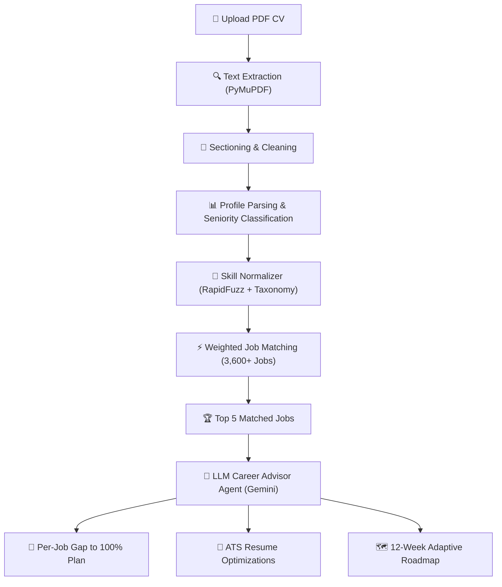

# 🤖 AI Career Matching & Recommendation System with LLM Agent

An advanced, end-to-end AI system designed to parse resumes, match candidates with 3,600+ active tech jobs (including Egypt tech hubs), calculate explainable match scores, and leverage an **LLM-Powered Career Advisor Agent** to provide tailored gap analysis, ATS resume feedback, and adaptive learning roadmaps.

---

## 🏗️ Project Architecture



---

## 📂 Directory Layout

```text
ai_project/
├── data/
│   ├── processed/
│   │   └── jobs_dataset.json          # 3,685 Active Live Tech Jobs
│   └── sample_cvs/                    # Test Resumes (Naser Ashraf, Full Stack, Frontend)
├── src/
│   ├── classifier.py                  # 5-Tier Seniority Classifier
│   ├── extractor.py                   # PyMuPDF Section Extractor
│   ├── normalizer.py                  # RapidFuzz Skill Normalizer
│   ├── parser.py                      # Pydantic Resume & Job Parser
│   ├── matcher.py                     # Weighted Multi-Metric Matcher
│   ├── recommender.py                 # Baseline Frequency Recommender
│   └── agent_advisor.py               # 🧠 LLM Career Advisor Agent (Gemini)
├── scripts/
│   ├── collect_jobs.py                # 5-Source Live Job Scraper
│   ├── clean_closed_jobs.py            # Expired Job Cleaner
│   └── check_stats.py                 # Dataset Analytics
├── skills_dictionary.json             # 100+ Skills & 12 Job Taxonomies
├── run_pipeline.py                    # Master CLI Pipeline
├── analyze_cv_json.py                 # JSON Output Generator
└── requirements.txt                   # Dependencies
```

---

## 🚀 Quick Start

### 1. Install Dependencies
```bash
py -m pip install -r requirements.txt
```

### 2. (Optional) Configure Gemini API Key
Add your free Gemini API key to `.env`:
```env
GEMINI_API_KEY=your_key_here
```

### 3. Run Master Pipeline on Resume
```bash
# Run on your CV:
py run_pipeline.py "data/sample_cvs/Naser_Ashraf_Resume.pdf"

# Run on all CVs:
py run_pipeline.py
```

### 4. Export JSON for Web Integration
```bash
py analyze_cv_json.py --pdf "data/sample_cvs/Naser_Ashraf_Resume.pdf" --top_n 5
```
